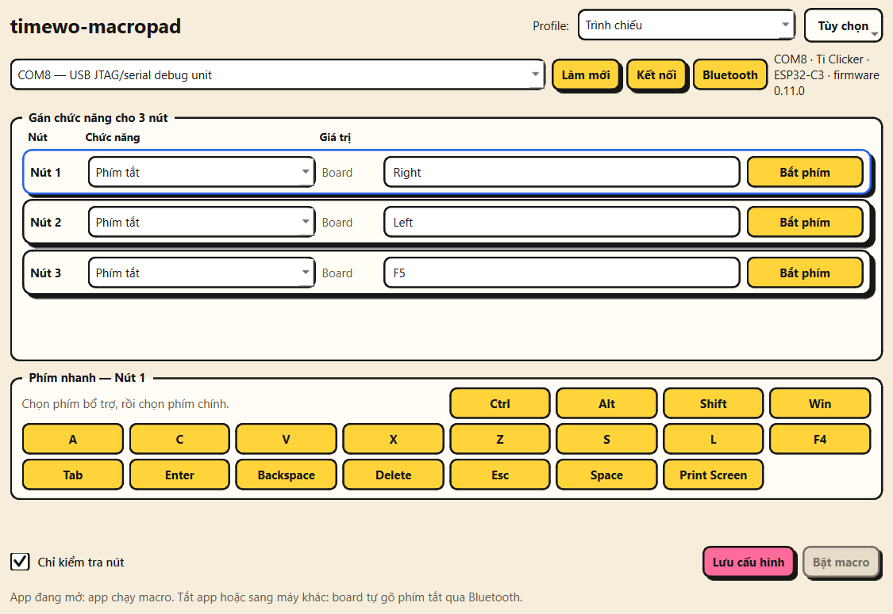
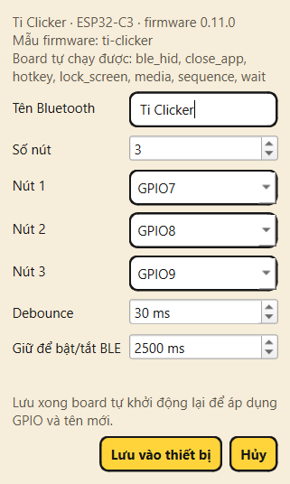
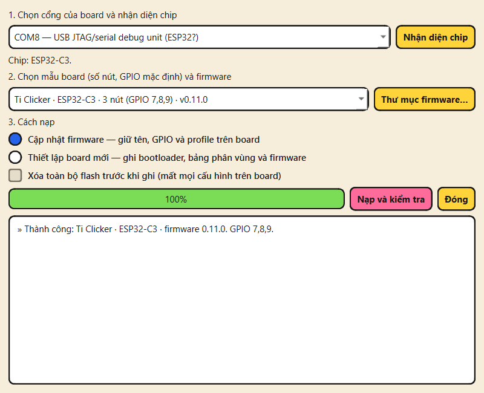

# timewo-macropad

Firmware và ứng dụng cấu hình/nạp firmware cho bàn phím macro BLE dùng ESP32.
Một firmware chung cho nhiều board; tên Bluetooth, số nút, GPIO và thời gian nút
là cấu hình lưu trên board, đổi trong app mà không cần build hay nạp lại.

**Tải về:** [bản mới nhất cho Windows](https://github.com/ti014/timewo-macropad/releases/latest).
Tải file `.zip`, giải nén rồi chạy EXE, không cần cài Python.



| Đổi tên, GPIO, thời gian nút | Nạp firmware và kiểm tra |
|---|---|
|  |  |

## Thành phần

- `src/`, `include/`: firmware PlatformIO (Arduino) cho ESP32-C3, ESP32-S3, ESP32.
- `desktop/`: ứng dụng PySide6 cấu hình profile, cấu hình thiết bị, nạp firmware,
  nhận nút qua USB Serial/BLE GATT.
- `build-firmware.ps1`: build mọi env và đóng gói vào `dist/firmware/<env>/`.
- `Mo-Macropad.cmd`: chạy bản desktop đã build.

## Board và chip hỗ trợ

| Env (mẫu board) | Chip | Nút mặc định | Tên mặc định |
|---|---|---|---|
| `esp32c3` | ESP32-C3 | GPIO 3/4/5/6 | timewo-macropad |
| `ti-clicker` | ESP32-C3 Super Mini | GPIO 7/8/9 | Ti Clicker |
| `esp32s3` | ESP32-S3 (USB gốc) | GPIO 4/5/6/7 | timewo-macropad |
| `esp32` | ESP32 (CP2102/CH340) | GPIO 25/26/27/32 | timewo-macropad |

ESP32-S2 không có Bluetooth nên không thể làm bàn phím BLE; app nhận diện và báo rõ.
ESP32-C6/H2 chưa có env vì nền tảng Arduino đang dùng chưa hỗ trợ.
Tối đa 4 nút. Nút được nối giữa GPIO và GND (pull-up nội, LOW = nhấn).

## Đấu nối

Mỗi nút một đầu nối GPIO, một đầu nối GND. Không cần điện trở ngoài.
Ví dụ Ti Clicker (ESP32-C3 Super Mini): nút 1 → GPIO7, nút 2 → GPIO8, nút 3 → GPIO9,
chân còn lại của cả ba nút nối chung GND. GPIO8/GPIO9 là chân strapping (chân quyết
định chế độ khởi động), nên đừng giữ nút 2/3 lúc cắm điện.

## Yêu cầu

- Windows 10/11 (app desktop; phần lớn code chạy được trên Linux, xem ghi chú bên dưới).
- Build firmware: [PlatformIO Core](https://platformio.org/install/cli) (`pio` trong PATH).
- Build/chạy app: [uv](https://docs.astral.sh/uv/) và Python 3.11–3.13.
- Chỉ dùng EXE đã build: không cần cài gì thêm.

## Build và chạy

```powershell
./build-firmware.ps1            # build + đóng gói firmware mọi board vào dist/firmware
cd desktop
uv sync --locked
uv run python main.py           # chạy từ source
./build.ps1                     # EXE: dist/v0.11-single/, kèm thư mục firmware/
```

`Mo-Macropad.cmd` mở bản EXE; máy sử dụng không cần cài Python.

## Nạp firmware trong app

`Tùy chọn → Thiết lập board mới / Nạp firmware…`:

1. Chọn cổng, bấm `Nhận diện chip` (esptool đọc loại chip).
2. Chọn mẫu board; danh sách chỉ hiện gói đúng chip.
3. `Cập nhật firmware` chỉ ghi `firmware.bin` ở 0x10000, giữ nguyên NVS (profile,
   tên, GPIO). `Thiết lập board mới` ghi thêm bootloader, bảng phân vùng, boot_app0;
   chỉ xóa toàn bộ flash khi bạn tự đánh dấu.
4. App kiểm tra SHA-256 từng file, nạp, rồi đợi board khởi động và trả lời `INFO`
   đúng chip và phiên bản mới mới báo thành công, sau đó tự kết nối.

Nạp bằng PlatformIO vẫn dùng được: `pio run -e ti-clicker -t upload`.

## Đổi tên, GPIO, thời gian nút

`Tùy chọn → Thiết bị (tên, GPIO, thời gian)…` (cần USB). Ví dụ: đổi `Ti Clicker`
thành `Remote Phuong`, nút 3 từ GPIO9 sang GPIO10, bấm `Lưu vào thiết bị`.
App gửi `CFG`, board kiểm tra (GPIO hợp lệ cho chip, không trùng, tên ≤15 byte),
lưu NVS, đọc lại và gửi `CONFIG`; app chỉ báo thành công khi dữ liệu trả về khớp.
Board tự khởi động lại để áp dụng; app tự kết nối lại. Máy đã ghép đôi có thể cần
xóa ghép đôi cũ để thấy tên mới.

Lưu profile qua USB cũng được đọc lại bằng `DUMP` và so sánh từng nút. Qua BLE
chưa có kênh trả lời nên log ghi `đã gửi`.

Giữ **nút cuối cùng** (mặc định 2,5 giây, chỉnh được) để bật/tắt Bluetooth.

## Hành động chạy trên board và trên máy tính

Danh sách hành động chia hai nhóm, mỗi hàng ghi `Board` hoặc `Máy tính`:

- Board tự chạy, kể cả khi đóng app hoặc ghép với máy khác: phím tắt, chuỗi phím
  (có bước chờ, ví dụ `Ctrl+L,wait:300,Ctrl+C`, tổng thời gian chờ tối đa 3000 ms), media,
  khóa màn hình, đóng ứng dụng.
- Cần app chạy nền trên máy tính: văn bản Unicode, mở ứng dụng, mở website, chụp
  màn hình vào clipboard, chạy script `.py/.pyw/.ps1/.bat/.cmd` (script `.py` dùng
  Python cài trên máy).

USB của board là Serial để cấu hình, không phải bàn phím USB HID.

## Cách dùng USB và Bluetooth

1. Đóng app cũ và Serial Monitor. Mở EXE mới, chọn cổng USB của board rồi bấm
   `Kết nối`. App đọc địa chỉ Bluetooth từ chính board để tránh chọn nhầm thiết bị.
2. Bấm `Bluetooth` để kết nối app với board. Nếu radio đang tắt và USB đã kết nối,
   thao tác này bật radio. Chấp nhận yêu cầu ghép đôi của Windows nếu xuất hiện.
3. Gán nút, bấm `Lưu cấu hình`, bỏ chọn `Chỉ kiểm tra nút`, rồi bấm `Bật macro`.
   Chuyển sang ứng dụng đích hoặc ẩn app xuống khay; macro không chạy khi cửa sổ
   cấu hình đang có focus.
4. App nhận nút qua cả hai đường, dùng ID sự kiện để chỉ chạy một lần. Khi mất
   kết nối, app nối lại và chỉ khôi phục macro nếu trước đó bạn đã bật. Tạm dừng
   hoặc sửa cấu hình sẽ hủy ý định tự khôi phục.

Giữ **nút cuối** (nút 4 trên macropad, nút 3 trên Ti Clicker) để bật/tắt radio Bluetooth, không reboot.
Nhấn ngắn nút cuối chạy macro khi thả nút. Bỏ chọn nút `Bluetooth` trên app chỉ ngắt
kết nối của app, không tắt radio hay bàn phím HID của hệ điều hành.

Ví dụ: gán `Mở ứng dụng` với `C:\Program Files\Cockpit Tools\cockpit-tools.exe`.
App gọi thẳng EXE qua hệ điều hành, không gõ đường dẫn vào Run nên không
bị Telex biến đổi. `Văn bản` dán Unicode bằng clipboard và Ctrl+V; thao tác này
thay nội dung clipboard và cần ứng dụng đích hỗ trợ dán. Xuống dòng trong văn bản
là dữ liệu được dán, không phải thao tác nhấn Enter riêng.

### Dùng không cần app, trên máy bất kỳ

Mỗi lần `Lưu cấu hình` (và mỗi lần app vừa kết nối board), app tự chép profile
vào flash của board. Board nhớ profile sau khi rút điện.

Ai chạy macro được quyết định tự động:
- App đang mở và kết nối board (USB hoặc Bluetooth): app gửi lệnh `APP` mỗi giây,
  board chỉ báo nút cho app và không tự gõ, nên không có chuyện chạy hai lần.
- Tắt app, app mất kết nối, hoặc board đang ghép với máy khác: sau tối đa 3 giây
  không nhận `APP`, board tự gõ phím tắt qua Bluetooth HID. Tắt app đúng cách
  (`Ngắt kết nối`/`Thoát`) thì board nhận lại ngay.

Ví dụ: lưu `BTN1 = Ctrl+C` trên máy A, mang board sang máy B, ghép Bluetooth
`timewo-macropad` như bàn phím thường; nhấn nút 1 trên máy B là copy.

Board chỉ tự gõ được phím tắt, chuỗi phím, khóa màn hình, đóng app, chụp màn hình
(PrintScreen) và phím media. Mở app, URL và văn bản cần app đang mở. Board là
bàn phím Bluetooth: không có Bluetooth thì USB một mình không gõ được phím.

`Tùy chọn → Chế độ board → Luôn để board gõ phím` buộc board tự gõ kể cả khi app
đang mở; app khi đó không chạy macro. Thường để `Tự động` là đủ.

Nút đang bị giữ lúc board khởi động được bỏ qua cho đến khi nhả ra, nên nút kẹt
không thể tự chạy macro hay bật/tắt Bluetooth.

App phải chạy nền và phiên desktop phải mở khóa để xử lý mở app, URL và văn bản.
Không dùng profile văn bản để lưu mật khẩu máy. Trên Linux, phần bàn phím và
clipboard còn phụ thuộc desktop/X11/Wayland; khóa màn hình hiện chỉ hỗ trợ Windows.

## Các module chính

```text
src/
  button_scanner.cpp   Quét nút theo GPIO/debounce/thời gian giữ lưu trong NVS
  ble_bridge.cpp       GATT sự kiện/lệnh, dùng chung server với BLE HID
  ble_controller.cpp   Board tự gõ phím khi không có app
  usb_protocol.cpp     Phân tích lệnh USB và GATT
  profile_store.cpp    Lưu gán nút, mode, tên, GPIO, thời gian trong NVS
desktop/macropad/
  device.py           INFO/CONFIG/DUMP: nhận diện board, kiểm tra cấu hình
  device_ui.py        Hộp thoại Thiết bị
  firmware.py         Gói firmware (manifest, SHA-256), chạy esptool
  flash_ui.py         Hộp thoại nạp firmware và kiểm tra sau khi nạp
  bridge_protocol.py   Gói sự kiện và chống trùng USB/BLE
  ble_transport.py     Worker Bluetooth, timeout và tự nối lại
  bridge_ui.py        Điều khiển kết nối và mode trong giao diện
  transport.py        USB Serial và nhận diện đúng board
  actions.py          Mở app/web, clipboard, phím tắt trên máy
```

Sự kiện BLE là 10 byte little-endian `<BBII>`: phiên bản, nút, ID lần khởi động,
số thứ tự. USB gửi cùng ID dưới dạng `EVT <session> <sequence> <button>`.
App bỏ sự kiện trùng/cũ, không phát lại macro bị bỏ qua trong lúc tạm dừng.
Kết nối BLE sử dụng pairing/encryption; việc ghi lệnh thành công không đồng nghĩa
đã xác nhận lưu profile. Log hiện ghi `Đã gửi`, không tuyên bố đã lưu khi chưa có ACK.

## Xử lý lỗi

- `Bluetooth trên board đang tắt`: giữ nút cuối hoặc kết nối USB rồi bật nút Bluetooth.
- Không thấy board khi tìm qua BLE: thiết lập lần đầu qua USB, bật Bluetooth trên
  Windows, kiểm tra board không đang bị máy khác giữ kết nối.
- Firmware mới có thêm GATT service. Nếu Windows vẫn dùng cache cũ và báo thiếu
  service, bạn có thể xóa ghép đôi của riêng `timewo-macropad` rồi ghép lại.
- Ghép đôi thất bại (`Could not pair`, lỗi xác thực/mã hóa): app tự gỡ ghép đôi
  Windows của riêng `timewo-macropad` và ghép lại ở lần thử sau; board cũng tự bỏ
  bond hỏng của máy đó. Nếu vẫn lỗi, **giữ nút 1 trong lúc cắm điện** để board xóa
  mọi ghép đôi đã lưu, rồi xóa `timewo-macropad` trong Windows Settings và ghép lại.
- Mở COM thất bại: đóng Serial Monitor hoặc app cũ đang chiếm cổng.
- Xem `Tùy chọn → Hiện nhật ký`; profile và log nằm trong
  `%LOCALAPPDATA%\Macropad\MacropadConfigurator`.
- Rút cáp nguồn làm board tắt hẳn. BLE chỉ tiếp tục khi board còn được cấp nguồn;
  chuyển sang sạc dự phòng có thể gây một lần khởi động lại.

## Kiểm thử

Bản 0.11.0 là bản kiểm thử tích hợp. Tests tự động gồm chống thực thi trùng,
pause/reconnect, đổi mode, clipboard, giao thức INFO/CFG/DUMP, kiểm tra gói firmware
và tham số esptool. Firmware build được cho cả 4 env. Đã thử trên ESP32-C3 Super Mini
(Ti Clicker): nạp đủ bootloader/phân vùng/firmware bằng code của app, INFO, lưu
profile có `wait:` và đọc lại bằng DUMP, CFG đổi tên/GPIO rồi tự kết nối lại sau
khoảng 1,2 giây, từ chối GPIO sai/trùng, BLE quảng bá đúng tên. Chưa thử trên board
ESP32 thường và ESP32-S3.

Chưa triển khai cửa sổ ghép đôi có thời hạn/allowlist và chưa có ACK xác nhận
lưu profile vào NVS qua BLE. Không suy ra tốc độ reconnect cố định từ vài lượt đo.

```powershell
cd desktop
$env:QT_QPA_PLATFORM = "offscreen"
uv run pytest -q
uv run ruff check macropad tests
```

## Giấy phép

MIT, xem [LICENSE](LICENSE). Tác giả: Phan Nguyễn Mai Phương.

Firmware dùng thư viện [ESP32-BLE-Keyboard](https://github.com/T-vK/ESP32-BLE-Keyboard)
(bản fork 5mustafa) và Arduino-ESP32; app dùng PySide6 (LGPL), pyserial, bleak, esptool
(GPL-2.0, chỉ gọi khi nạp firmware). Khi phát hành EXE đóng gói các thư viện này,
hãy tuân theo giấy phép của từng thư viện.

