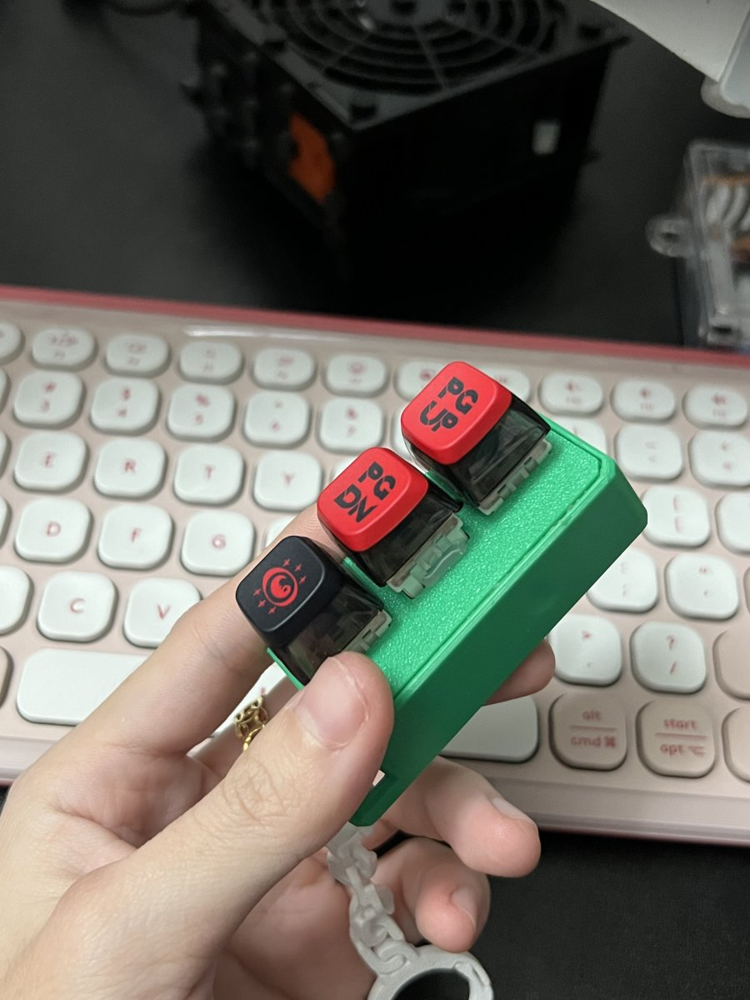
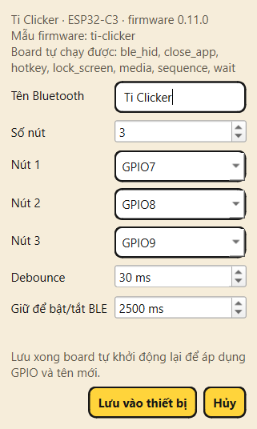

# timewo-macropad

Firmware và ứng dụng cấu hình/nạp firmware cho bàn phím macro BLE dùng ESP32.
Một firmware chung cho nhiều board; tên Bluetooth, số nút, GPIO và thời gian nút
là cấu hình lưu trên board, đổi trong app mà không cần build hay nạp lại.

<p align="center">
  
</p>

Ti Clicker, sản phẩm hoàn thiện: ESP32-C3 Super Mini trong vỏ in 3D, 3 phím cơ
(PgUp, PgDn và một phím tùy chọn), dùng làm remote trình chiếu qua Bluetooth.

**Tải về:** [bản mới nhất cho Windows](https://github.com/ti014/timewo-macropad/releases/latest).
Tải file `.zip`, giải nén **cả EXE và thư mục `firmware/` cạnh EXE**, rồi chạy app;
không cần cài Python. Link trên trỏ tới release đã công khai, không phải bản draft.
Hướng dẫn và ảnh cửa sổ chính/hộp nạp bên dưới dùng giao diện **v0.11.1**;
nếu bản tải về còn là v0.11.0, giao diện sẽ khác.

**Nạp và cấu hình trên trình duyệt, không cần cài gì:**
[ti014.github.io/timewo-macropad](https://ti014.github.io/timewo-macropad/).
Mở bằng Chrome hoặc Edge trên máy tính, cắm board qua USB, bấm `Nạp firmware`,
rồi `Kết nối board` để đổi GPIO, số nút và gán phím tắt/chuỗi phím. Trang chỉ gán
được các chức năng board tự chạy; mở app, website hay script vẫn cần app Windows.


## Bắt đầu nhanh

- **Board đã có firmware:** không cần nạp lại. Cắm cáp USB có truyền dữ liệu,
  bấm `Làm mới`, chọn COM của board rồi `Kết nối`.
- **Board mới hoặc cần khôi phục:** bấm `Nạp firmware…` ngay cửa sổ chính,
  làm theo phần [nạp firmware](#nạp-firmware-trong-app), rồi kết nối board.
- **Dùng dây USB:** app phải chạy nền; không cần Bluetooth.
- **Dùng độc lập, không mở app:** lưu profile vào board rồi ghép Bluetooth HID
  với máy đích. USB lúc đó chỉ cần cấp nguồn.

**Lưu ý:** mỗi lần kết nối lại, app chép profile đang chọn vào board. Chọn đúng
profile trước khi kết nối; kết nối không có nghĩa là đọc profile từ board về app.
Cắm USB hoặc bấm `Kết nối` không tự nạp firmware.

Thanh dưới có `Chỉ kiểm tra nút`, `Nạp firmware…`, `Lưu cấu hình`, `Bật macro`.
App khởi động ở chế độ kiểm tra; dòng trạng thái phía dưới cho biết vì sao macro
chưa chạy. Sửa cấu hình sẽ tạm dừng macro, cần lưu và bật lại.

## Thành phần

- `src/`, `include/`: firmware PlatformIO (Arduino) cho ESP32-C3, ESP32-S3, ESP32.
- `desktop/`: ứng dụng PySide6 cấu hình profile, cấu hình thiết bị, nạp firmware,
  nhận nút qua USB Serial/BLE GATT.
- `build-firmware.ps1`: build mọi env và đóng gói vào `dist/firmware/<env>/`.
- `Mo-Macropad.cmd`: chạy bản desktop đã build.

## Board và chip hỗ trợ

| Env (mẫu board) | Chip | Nút mặc định | Tên mặc định |
|---|---|---|---|
| `esp32c3` | ESP32-C3 | GPIO 3/4/5/6 | timewo-macropad |
| `ti-clicker` | ESP32-C3 Super Mini | GPIO 7/8/9 | Ti Clicker |
| `esp32s3` | ESP32-S3 (USB gốc) | GPIO 4/5/6/7 | timewo-macropad |
| `esp32` | ESP32 (CP2102/CH340) | GPIO 25/26/27/32 | timewo-macropad |

ESP32-S2 không có Bluetooth nên không thể làm bàn phím BLE; app nhận diện và báo rõ.
ESP32-C6/H2 chưa có env vì nền tảng Arduino đang dùng chưa hỗ trợ.
Tối đa 9 nút. Nút được nối giữa GPIO và GND (pull-up nội, LOW = nhấn).

## Đấu nối

Mỗi nút một đầu nối GPIO, một đầu nối GND. Không cần điện trở ngoài.
Ví dụ Ti Clicker (ESP32-C3 Super Mini): nút 1 → GPIO7, nút 2 → GPIO8, nút 3 → GPIO9,
chân còn lại của cả ba nút nối chung GND. GPIO8/GPIO9 là chân strapping (chân quyết
định chế độ khởi động), nên đừng giữ nút 2/3 lúc cắm điện.

## Yêu cầu

- Windows 10/11 (app desktop; phần lớn code chạy được trên Linux, xem ghi chú bên dưới).
- Build firmware: [PlatformIO Core](https://platformio.org/install/cli) (`pio` trong PATH).
  Platform `espressif32` khóa ở `6.10.0` (Arduino-ESP32 2.x) để khớp BLE API hiện tại.
- Build/chạy app: [uv](https://docs.astral.sh/uv/) và Python 3.11–3.13.
- Chỉ dùng EXE đã build: không cần cài gì thêm.

## Build và chạy

```powershell
./build-firmware.ps1            # build + đóng gói firmware mọi board vào dist/firmware
cd desktop
uv sync --locked
uv run python main.py           # chạy từ source
./build.ps1                     # EXE: dist/v0.11.1-single/, kèm thư mục firmware/
```

`Mo-Macropad.cmd` mở bản EXE; máy sử dụng không cần cài Python.

## Nạp firmware trong app

Mở `Nạp firmware…` trên cửa sổ chính (hoặc mục nạp firmware trong `Tùy chọn`).
Cắm USB hay bấm kết nối **không tự nạp firmware**.


Ảnh minh họa trạng thái trước nhận diện; mẫu board đang hiện chưa phải kết quả
nhận diện phần cứng. Sau nhận diện, chọn đúng mẫu và GPIO, không chỉ đúng chip.

| Tình trạng board | Cách nạp |
|---|---|
| Đang chạy firmware của dự án, chỉ nâng phiên bản | `Cập nhật / Nạp đè` |
| Board trắng hoặc cần ghi lại bootloader/phân vùng | `Nạp mới / Khôi phục` |
| Muốn xóa cả cấu hình và ghép đôi cũ | `Nạp mới / Khôi phục` và chọn `Xóa toàn bộ flash` |

**Xóa toàn bộ flash làm mất tên, GPIO, profile và ghép đôi đã lưu. Mặc định không chọn.**
Nạp mới không tự đổi cấu hình NVS còn tồn tại về mặc định của mẫu board.

1. Chọn cổng, bấm `Nhận diện chip` (esptool đọc loại chip). Nếu vừa cắm board,
   bấm `Tìm lại cổng`; đổi cổng phải nhận diện lại trước khi nạp.
2. Chọn mẫu board; danh sách chỉ hiện gói đúng chip. Nếu chạy từ source chưa có gói,
   build bằng `./build-firmware.ps1 -Env esp32c3` cho board C3 4 nút, rồi chọn
   thư mục `dist/firmware`.
3. `Cập nhật / Nạp đè` chỉ ghi `firmware.bin` ở 0x10000, giữ nguyên NVS (profile,
   tên, GPIO). `Nạp mới / Khôi phục` ghi thêm bootloader, bảng phân vùng, boot_app0;
   vẫn giữ cấu hình cũ nếu không chọn `Xóa toàn bộ flash`. Chỉ chọn xóa khi muốn
   thiết lập lại từ đầu và chấp nhận mất cấu hình/ghép đôi trên board.
4. Bấm `Nạp và kiểm tra`, kiểm tra cổng, mẫu board và cảnh báo trong hộp xác nhận.
   App kiểm tra SHA-256 từng file, nạp, rồi đợi board khởi động và trả lời `INFO`
   đúng chip và phiên bản mới mới báo thành công. Các điều khiển bị khóa đến khi
   kiểm tra xong; không rút cáp trong lúc này.

Sau khi log báo `Thành công`, đóng hộp nạp để app kết nối lại và đồng bộ profile
đang chọn. Thanh tiến trình 100% chỉ có nghĩa ghi flash xong; vẫn cần chờ bước
kiểm tra board trả lời. Nhận diện chip không ghi firmware, nhưng có thể reset board
và ngắt kết nối USB của app.

Nạp bằng PlatformIO vẫn dùng được: `pio run -e ti-clicker -t upload`.

## Đổi tên, GPIO, thời gian nút



`Tùy chọn → Thiết bị (tên, GPIO, thời gian)…` (cần USB). Ví dụ: đổi `Ti Clicker`
thành `Remote Phuong`, nút 3 từ GPIO9 sang GPIO10, bấm `Lưu vào thiết bị`.
App gửi `CFG`, board kiểm tra (GPIO hợp lệ cho chip, không trùng, tên ≤15 byte),
lưu NVS, đọc lại và gửi `CONFIG`; app chỉ báo thành công khi dữ liệu trả về khớp.
Board tự khởi động lại để áp dụng; app tự kết nối lại. Máy đã ghép đôi có thể cần
xóa ghép đôi cũ để thấy tên mới.

Lưu profile qua USB cũng được đọc lại bằng `DUMP` và so sánh từng nút. Qua BLE
chưa có kênh trả lời nên log ghi `đã gửi`.

Giữ **nút cuối cùng** (mặc định 2,5 giây, chỉnh được) để bật/tắt Bluetooth.

## Hành động chạy trên board và trên máy tính

Danh sách hành động chia hai nhóm, mỗi hàng ghi `Board` hoặc `Máy tính`:

- Board tự chạy, kể cả khi đóng app hoặc ghép với máy khác: phím tắt, chuỗi phím
  (có bước chờ, ví dụ `Ctrl+L,wait:300,Ctrl+C`, tổng thời gian chờ tối đa 3000 ms), media,
  khóa màn hình, đóng ứng dụng.
- Cần app chạy nền trên máy tính: văn bản Unicode, mở ứng dụng, mở website, chụp
  màn hình vào clipboard, chạy script `.py/.pyw/.ps1/.bat/.cmd` (script `.py` dùng
  Python cài trên máy).

USB của board là Serial để cấu hình, không phải bàn phím USB HID.

## Cách dùng USB và Bluetooth

### USB: app chạy macro, Bluetooth không bắt buộc

1. Đóng app cũ hoặc Serial Monitor đang giữ cổng. Cắm board, bấm `Làm mới`,
   chọn COM rồi `Kết nối`. Đợi app nhận diện và đồng bộ xong.
2. Để `Tùy chọn → Chế độ board → Tự động`. Chọn profile, gán nút rồi bấm
   `Lưu cấu hình`.
3. Bỏ chọn `Chỉ kiểm tra nút`, bấm `Bật macro`.
4. Chuyển sang cửa sổ đích hoặc chọn `Tùy chọn → Ẩn xuống khay`. Giữ app chạy nền;
   đóng app sẽ ngừng xử lý macro USB. Macro không chạy khi cửa sổ app có focus.

USB của firmware là Serial, **không phải USB keyboard HID**. Cắm board vào máy khác
không tự biến nó thành bàn phím USB; máy đó cần app hoặc phải ghép Bluetooth HID.

### Bluetooth: phân biệt kết nối app và bàn phím độc lập

- **Nút `Bluetooth (tùy chọn)` trong app:** kết nối app với board qua BLE GATT để
  nhận nút/gửi cấu hình. Thiết lập lần đầu qua USB để app đọc đúng địa chỉ board;
  nếu radio đang tắt, app có thể bật qua USB. Chấp nhận yêu cầu ghép đôi Windows
  nếu xuất hiện. Khi app xử lý macro, vẫn cần lưu, bỏ chế độ kiểm tra và bật macro.
- **Bàn phím Bluetooth HID không cần app:** lưu các hành động hỗ trợ trên board,
  giữ nút cuối để bật radio nếu đang tắt, ghép board trong Bluetooth Settings của
  máy đích rồi ngắt kết nối/thoát app. Board dùng cùng firmware và profile đã lưu,
  không cần nạp một firmware Bluetooth riêng. Xem phần dùng độc lập bên dưới.

App nhận nút qua USB và BLE thì dùng ID sự kiện để chỉ chạy một lần. Khi mất
kết nối, app nối lại và chỉ khôi phục macro nếu trước đó đã bật; tạm dừng hoặc
sửa cấu hình sẽ hủy ý định tự khôi phục.

Giữ **nút cuối** (nút 4 trên macropad, nút 3 trên Ti Clicker) để bật/tắt radio Bluetooth, không reboot.
Nhấn ngắn nút cuối chạy macro khi thả nút. Bỏ chọn nút `Bluetooth (tùy chọn)` chỉ ngắt
kết nối của app, không tắt radio hay bàn phím HID của hệ điều hành.

**Ghép máy mới (board từ 9 nút):** giữ nút 9, rồi giữ thêm nút 6 khoảng thời gian giữ
(mặc định 2,5 giây). Board xóa ghép đôi cũ, đổi sang một địa chỉ Bluetooth mới và khởi
động lại. Máy cũ chỉ nhớ địa chỉ cũ nên không tự kết nối lại được; máy mới thấy
`timewo-macropad` như thiết bị mới để ghép. Trong tổ hợp, nút 6 và 9 không chạy macro
và nút 9 không bật/tắt radio. Máy cũ còn một mục `timewo-macropad` không dùng được nữa,
có thể xóa trong Bluetooth Settings. Board ít nút hơn: giữ nút 1 khi cắm điện để xóa
ghép đôi (giữ nguyên địa chỉ).

Ví dụ: gán `Mở ứng dụng` với `C:\Program Files\Cockpit Tools\cockpit-tools.exe`.
App gọi thẳng EXE qua hệ điều hành, không gõ đường dẫn vào Run nên không
bị Telex biến đổi. `Văn bản` dán Unicode bằng clipboard và Ctrl+V; thao tác này
thay nội dung clipboard và cần ứng dụng đích hỗ trợ dán. Xuống dòng trong văn bản
là dữ liệu được dán, không phải thao tác nhấn Enter riêng.

### Dùng không cần app, trên máy bất kỳ

Mỗi lần `Lưu cấu hình` (và mỗi lần app vừa kết nối board), app tự chép profile
vào flash của board. Board nhớ profile sau khi rút điện.

Ai chạy macro được quyết định tự động:
- App đang mở và kết nối board (USB hoặc Bluetooth): app gửi lệnh `APP` mỗi giây,
  board chỉ báo nút cho app và không tự gõ, nên không có chuyện chạy hai lần.
- Tắt app, app mất kết nối, hoặc board đang ghép với máy khác: sau tối đa 3 giây
  không nhận `APP`, board tự gõ phím tắt qua Bluetooth HID. Tắt app đúng cách
  (`Ngắt kết nối`/`Thoát`) thì board nhận lại ngay.

Ví dụ: lưu `BTN1 = Ctrl+C` trên máy A, mang board sang máy B, ghép Bluetooth
`timewo-macropad` như bàn phím thường; nhấn nút 1 trên máy B là copy.

Board chỉ tự gõ được phím tắt, chuỗi phím, khóa màn hình, đóng app, chụp màn hình
(PrintScreen) và phím media. Mở app, URL và văn bản cần app đang mở. Board là
bàn phím Bluetooth: không có Bluetooth thì USB một mình không gõ được phím.

`Tùy chọn → Chế độ board → Luôn để board gõ phím` buộc board tự gõ kể cả khi app
đang mở; app khi đó không chạy macro. Thường để `Tự động` là đủ.

Nút đang bị giữ lúc board khởi động được bỏ qua cho đến khi nhả ra, nên nút kẹt
không thể tự chạy macro hay bật/tắt Bluetooth.

App phải chạy nền và phiên desktop phải mở khóa để xử lý mở app, URL và văn bản.
Không dùng profile văn bản để lưu mật khẩu máy. Trên Linux, phần bàn phím và
clipboard còn phụ thuộc desktop/X11/Wayland; khóa màn hình hiện chỉ hỗ trợ Windows.

## Các module chính

```text
src/
  button_scanner.cpp   Quét nút theo GPIO/debounce/thời gian giữ lưu trong NVS
  ble_bridge.cpp       GATT sự kiện/lệnh, dùng chung server với BLE HID
  ble_controller.cpp   Board tự gõ phím khi không có app
  usb_protocol.cpp     Phân tích lệnh USB và GATT
  profile_store.cpp    Lưu gán nút, mode, tên, GPIO, thời gian trong NVS
desktop/macropad/
  device.py           INFO/CONFIG/DUMP: nhận diện board, kiểm tra cấu hình
  device_ui.py        Hộp thoại Thiết bị
  firmware.py         Gói firmware (manifest, SHA-256), chạy esptool
  flash_ui.py         Hộp thoại nạp firmware và kiểm tra sau khi nạp
  bridge_protocol.py   Gói sự kiện và chống trùng USB/BLE
  ble_transport.py     Worker Bluetooth, timeout và tự nối lại
  bridge_ui.py        Điều khiển kết nối và mode trong giao diện
  transport.py        USB Serial và nhận diện đúng board
  actions.py          Mở app/web, clipboard, phím tắt trên máy
```

Sự kiện BLE là 10 byte little-endian `<BBII>`: phiên bản, nút, ID lần khởi động,
số thứ tự. USB gửi cùng ID dưới dạng `EVT <session> <sequence> <button>`.
App bỏ sự kiện trùng/cũ, không phát lại macro bị bỏ qua trong lúc tạm dừng.
Kết nối BLE sử dụng pairing/encryption; việc ghi lệnh thành công không đồng nghĩa
đã xác nhận lưu profile. Log hiện ghi `Đã gửi`, không tuyên bố đã lưu khi chưa có ACK.

## Xử lý lỗi

| Triệu chứng | Kiểm tra / cách xử lý |
|---|---|
| Không thấy COM | Dùng cáp có truyền dữ liệu, đổi cổng USB; bấm `Làm mới` ở cửa sổ chính hoặc `Tìm lại cổng` trong hộp nạp. Với board dùng CP2102/CH340, kiểm tra driver tương ứng. |
| Có COM nhưng không kết nối được app | COM chỉ cho biết có cổng Serial, không chứng minh đã có firmware tương thích. Đóng app/Serial Monitor đang giữ cổng; nếu board trắng, dùng `Nạp mới / Khôi phục`. |
| `Nạp và kiểm tra` bị khóa | Phải `Nhận diện chip` thành công trên cổng đang chọn và có gói đúng chip. Đổi hoặc tìm lại cổng phải nhận diện lại. |
| Không có gói firmware | Giữ thư mục `firmware/` cạnh EXE. Nếu chạy source, build từ gốc repo rồi chọn `dist/firmware` bằng `Thư mục firmware…`. |
| Không nhận diện được chip | Kiểm tra cáp và cổng đang bị chiếm; thử giữ BOOT khi cắm board theo hướng dẫn phần cứng, rồi nhận diện lại. |
| Ghi đạt 100% nhưng board chưa trả lời | Chưa được xác nhận nạp thành công. Đợi kiểm tra kết thúc; nếu báo lỗi, rút/cắm lại, tìm COM mới và `Kết nối`. Không xóa flash ngay chỉ vì timeout. |
| Bấm nút nhưng macro không chạy | Đợi đồng bộ xong, chọn `Tự động`, lưu cấu hình, bỏ `Chỉ kiểm tra nút`, bật macro rồi chuyển focus sang cửa sổ đích. Xem dòng trạng thái phía dưới. |
| Tắt app thì USB không chạy | Đúng thiết kế: USB cần app. Muốn dùng độc lập phải ghép Bluetooth HID và dùng hành động hỗ trợ trên board. |
| Nạp mẫu 4 nút nhưng vẫn thấy cấu hình cũ | NVS được giữ nếu không xóa flash. Chỉnh GPIO/số nút trong hộp `Thiết bị`; chỉ xóa flash khi chấp nhận mất toàn bộ cấu hình. |

- `Bluetooth trên board đang tắt`: giữ nút cuối hoặc kết nối USB rồi bật `Bluetooth (tùy chọn)`.
- Không thấy board khi tìm qua BLE: thiết lập lần đầu qua USB, bật Bluetooth trên
  Windows, kiểm tra board không đang bị máy khác giữ kết nối.
- Firmware mới có thêm GATT service. Nếu Windows vẫn dùng cache cũ và báo thiếu
  service, bạn có thể xóa ghép đôi của riêng `timewo-macropad` rồi ghép lại.
- Ghép đôi thất bại (`Could not pair`, lỗi xác thực/mã hóa): app tự gỡ ghép đôi
  Windows của riêng `timewo-macropad` và ghép lại ở lần thử sau; board cũng tự bỏ
  bond hỏng của máy đó. Nếu vẫn lỗi, **giữ nút 1 trong lúc cắm điện** để board xóa
  mọi ghép đôi đã lưu, rồi xóa `timewo-macropad` trong Windows Settings và ghép lại.
- Mở COM thất bại: đóng Serial Monitor hoặc app cũ đang chiếm cổng.
- Xem `Tùy chọn → Hiện nhật ký`; profile và log nằm trong
  `%LOCALAPPDATA%\Macropad\MacropadConfigurator`.
- Rút cáp nguồn làm board tắt hẳn. BLE chỉ tiếp tục khi board còn được cấp nguồn;
  chuyển sang sạc dự phòng có thể gây một lần khởi động lại.

## Kiểm thử

Khi chuẩn bị v0.11.1: **192 tests đạt**, Ruff sạch, firmware build và kiểm tra
SHA-256 cho cả 4 env; EXE đóng gói vượt smoke-test. Tests gồm chống thực thi trùng,
pause/reconnect, đổi mode, clipboard, INFO/CFG/DUMP, gói firmware và esptool 5,
bắt buộc nhận diện trước nạp, hủy xác nhận không ghi, nạp đè/nạp mới và timeout
kiểm tra sau nạp. Đây là kết quả kiểm tra phần mềm, không thay thế thử phần cứng.

Kiểm thử tích hợp phần cứng v0.11.0 trên ESP32-C3 Super Mini (Ti Clicker) đã gồm:
nạp đủ bootloader/phân vùng/firmware bằng code của app, INFO, lưu profile có `wait:`
và đọc lại bằng DUMP, CFG đổi tên/GPIO rồi tự kết nối lại, từ chối GPIO sai/trùng,
BLE quảng bá đúng tên. Trong lượt chuẩn bị release v0.11.1 đã nhận diện ESP32-C3
qua esptool mới, chưa thực hiện lượt nạp thử phần cứng mới. Chưa thử ESP32 thường
và ESP32-S3; không coi build thành công là đã kiểm thử các board đó.

Chưa triển khai cửa sổ ghép đôi có thời hạn/allowlist và chưa có ACK xác nhận
lưu profile vào NVS qua BLE. Không suy ra tốc độ reconnect cố định từ vài lượt đo.

```powershell
cd desktop
$env:QT_QPA_PLATFORM = "offscreen"
uv run pytest -q
uv run ruff check macropad tests
```

## Giấy phép

MIT, xem [LICENSE](LICENSE). Tác giả: Phan Nguyễn Mai Phương.

Firmware dùng thư viện [ESP32-BLE-Keyboard](https://github.com/T-vK/ESP32-BLE-Keyboard)
(bản fork 5mustafa) và Arduino-ESP32; app dùng PySide6 (LGPL), pyserial, bleak, esptool
(GPL-2.0, chỉ gọi khi nạp firmware). Khi phát hành EXE đóng gói các thư viện này,
hãy tuân theo giấy phép của từng thư viện.

